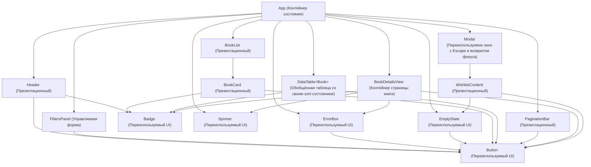

# Декомпозиция компонентов и размещение состояния (ЛР 5 · W6)

## 1. Схема дерева компонентов

---

## 2. Полный список компонентов (13 компонентов, из них 9 презентационных)

### Переиспользуемые базовые UI-элементы (Презентационные, без состояния)
1. **`Button`** (`src/components/Button.tsx`) — универсальная кнопка с вариантами оформления (`primary`, `secondary`, `outline`, `danger`, `wishlist`). Применяется в `Header`, `FiltersPanel`, `BookCard`, `PaginationBar`, `ErrorBox`, `EmptyState`, `WishlistContent`, `BookDetailsView`.
2. **`Badge`** (`src/components/Badge.tsx`) — индикатор/метка с вариантами (`accent`, `success`, `danger`, `neutral`). Применяется минимум в 3 местах:
   - счётчик книг в «Мой список» в шапке (`Header`);
   - статус наличия книги («В наличии» / «Нет в наличии») в карточке (`BookCard`) и таблице (`DataTable`);
   - статус наличия и количество найденных записей на странице книги (`BookDetailsView`).
3. **`Spinner`** (`src/components/Spinner.tsx`) — индикатор загрузки с текстовой подписью и `role="status"`. Применяется в каталоге (`App`) и в деталях книги (`BookDetailsView`).
4. **`EmptyState`** (`src/components/EmptyState.tsx`) — блок пустого результата с кнопкой действия. Применяется при отсутствии книг в каталоге (`App`) и при пустом списке желаемого (`WishlistContent`).
5. **`ErrorBox`** (`src/components/ErrorBox.tsx`) — карточка ошибки с различением сетевых сбоев, 4xx и 5xx и кнопкой «Повторить». Применяется при ошибке загрузки каталога (`App`) и при ошибке 404/сети в деталях книги (`BookDetailsView`).

### Предметные презентационные компоненты (без состояния)
6. **`Header`** (`src/components/Header.tsx`) — шапка приложения с навигацией (Каталог / Карточка книги), переключателем темы (`light` / `dark`) и кнопкой открытия списка желаемого со счётчиком `Badge`.
7. **`BookCard`** (`src/components/BookCard.tsx`) — карточка отдельной книги: обложка с резервной заглушкой, название, автор, жанр, год, рейтинг, `Badge` наличия и кнопки `Button` («Хочу прочитать» и «Подробнее»).
8. **`BookList`** (`src/components/BookList.tsx`) — сетка карточек книг (принимает вычисленный массив `books`, `wishlistIds`, колбэки переключения избранного и выбора книги). Ключом каждой карточки служит уникальный `book.id`.
9. **`PaginationBar`** (`src/components/PaginationBar.tsx`) — панель постраничной навигации («Назад», «Страница X из Y», «Вперёд») и накопительной подгрузки («Показать ещё 20 книг»).
10. **`WishlistContent`** (`src/components/WishlistContent.tsx`) — список сохранённых книг внутри модального окна с использованием `EmptyState` (когда список пуст) и кнопок удаления.

### Компоненты с состоянием / управляемой логикой
11. **`FiltersPanel`** (`src/components/FiltersPanel.tsx`) — панель поиска, выбора жанра, сортировки и чекбокса «Только доступные». Получает значения и обработчики из `App` (состояние поднято в `App`).
12. **`Modal`** (`src/components/Modal.tsx`) — переиспользуемое модальное окно с `children`, закрытием по клавише `Escape`, клику по фону и автоматическим возвратом фокуса на элемент-триггер.
13. **`DataTable<T>`** (`src/components/DataTable.tsx`) — универсальная обобщённая (`generic`) таблица с внутренней сортировкой по любому выбранному столбцу (`sortKey`, `sortDirection`).
14. **`BookDetailsView`** (`src/components/BookDetailsView.tsx`) — экран детальной карточки книги (загрузка по `id` из Open Library API, обработка 404 через `ErrorBox`, блок похожих книг по жанру и году).

---

## 3. Размещение состояния и обоснование (State Ownership)

| Фрагмент состояния | Владелец | Тип данных | Почему размещено именно здесь |
| :--- | :--- | :--- | :--- |
| `filters` (`query`, `genre`, `onlyAvailable`) и `sortBy` | `App` | `CatalogFilters`, `SortOption` | Необходимо одновременно для `FiltersPanel` (отображение текущих контролов), сетевого эффекта загрузки API и вычисления производного списка `visibleBooks` для `BookList` / `DataTable` и `EmptyState`. |
| `books`, `uiState`, `error`, `page`, `totalPages`, `totalFound`, `isLoadingMore` | `App` | `Book[]`, `UiState`, `ApiError \| null`, `number`, `boolean` | Данные каталога из Open Library API используются как в основном списке (`BookList` / `DataTable`), так и в панели пагинации (`PaginationBar`) и шапке списка. |
| `wishlist` | `App` (синхронизировано с `localStorage`) | `WishlistItem[]` | Нужен в `Header` (счётчик в `Badge`), в `BookCard` / `BookDetailsView` (кнопка «В желаемом») и в модальном окне `WishlistContent`. |
| `isWishlistOpen` | `App` | `boolean` | Управляется кнопкой в `Header` и закрывается из `Modal`. |
| `theme` (`'light' \| 'dark'`) | `App` (синхронизировано с `localStorage`) | `ThemeMode` | Глобальная тема оформления, переключается в `Header` и применяется к корневому контейнеру приложения. |
| `viewMode` (`'grid' \| 'table'`) и `selectedBookId` | `App` | `CatalogViewMode`, `string \| null` | Переключают отображение между сеткой карточек (`BookList`), таблицей (`DataTable<Book>`) и детальной страницей книги (`BookDetailsView`). |
| `sortColumnKey`, `sortDirection` | `DataTable<T>` | `keyof T \| null`, `'asc' \| 'desc'` | Локальное состояние сортировки таблицы по столбцам не нужно другим компонентам за пределами `DataTable`. |
| `bookDetails`, `similarBooks`, `detailsUiState`, `detailsError` | `BookDetailsView` | `BookDetails \| null`, `Book[]`, `UiState`, `ApiError \| null` | Изолированное состояние загрузки конкретной книги по ID и её похожих книг. |

---

## 4. Производные данные (вычисляются при рендере, НЕ хранятся в `state`)

- **`visibleBooks`** — вычисляется в `App` при каждом рендере через чистую функцию `getVisibleBooks(books, filters, sortBy)` из `src/lib/books.ts`.
- **`effectiveUiState`** — вычисляется при рендере: если `uiState === 'success'`, но после фильтрации `visibleBooks.length === 0`, отображается состояние `'empty'`.
- **`wishlistIds`** (`Set<string>`) и **`wishlistCount`** (`wishlist.length`) — вычисляются на лету из массива `wishlist`.
