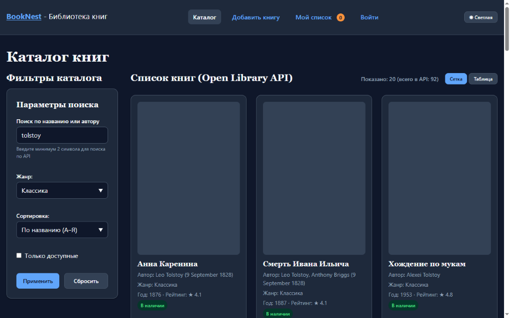
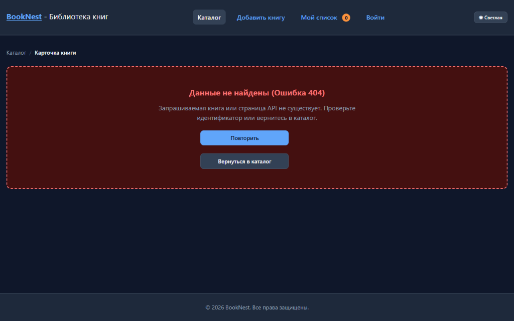
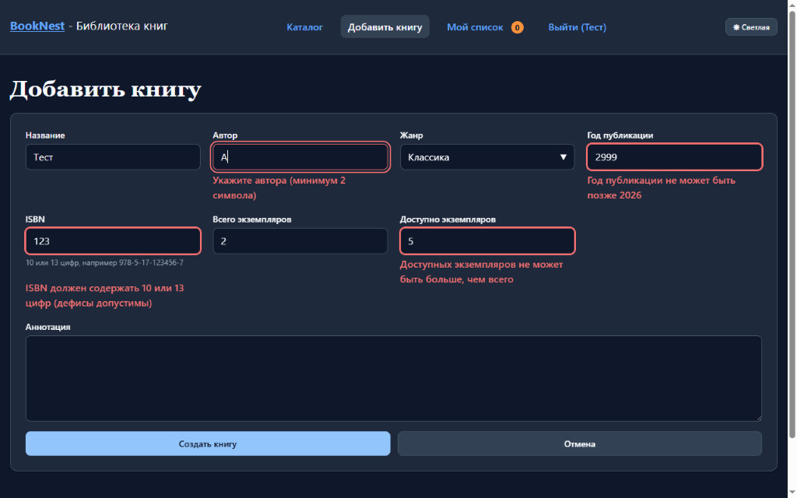
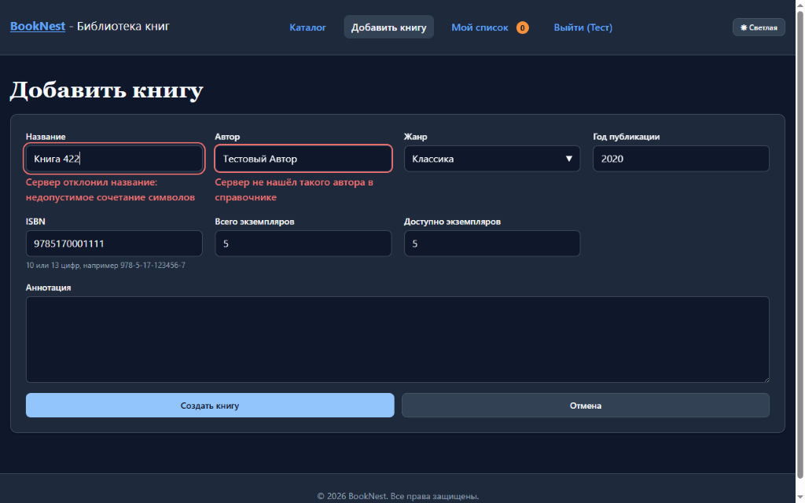
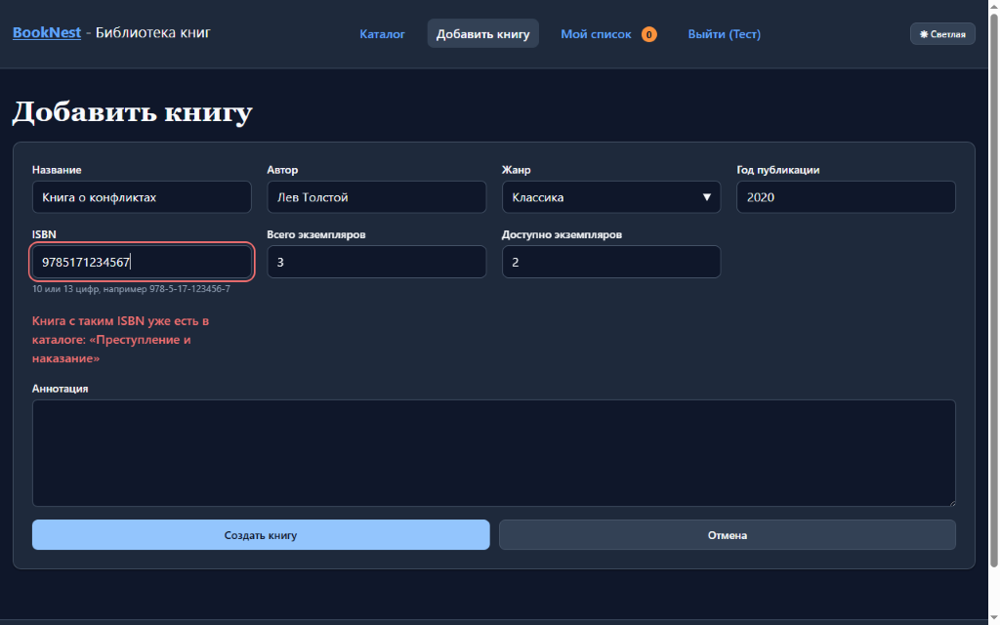
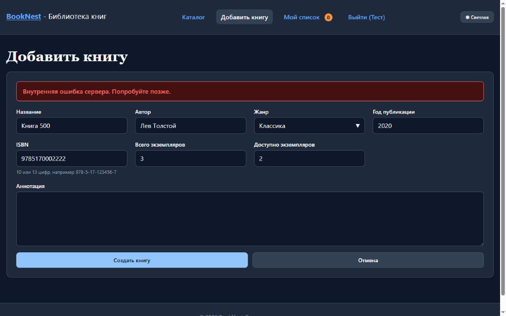
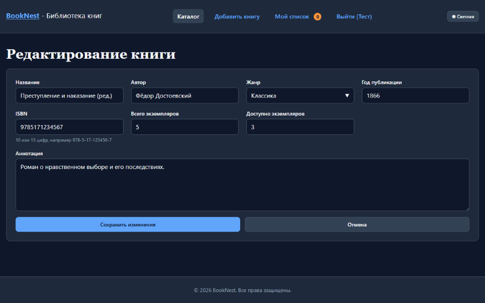

# Маршрутизация, хуки и формы с валидацией (ЛР 6 · W7–W8)

## 1. Структура проекта по слоям

Код клиентского приложения разделён на слои с однонаправленными зависимостями (`app -> pages -> features -> shared -> api`):

- `src/api/` — единая точка обращения к сети (`client.ts`, `books.ts`, `localBooks.ts`, `genres.ts`, `types.ts`). Ни один компонент не вызывает `fetch` напрямую.
- `src/shared/` — переиспользуемые примитивы (`ui/Button`, `ui/Badge`, `ui/Modal`, `ui/FormField`, `ui/DataTable`, `ui/ErrorBox`, `ui/EmptyState`, `ui/Spinner`, `ui/PaginationBar`), общие хуки (`useFetch`, `useDebounce`, `useUnsavedChangesGuard`), утилиты (`lib/books`, `lib/storage`) и контексты (`ThemeContext`, `AuthContext`).
- `src/features/` — функциональные модули предметной области:
  - `catalog/` (`useBooks`, `useCatalog`, `FiltersPanel`, `CatalogContent`, `BookList`, `BookCard`)
  - `book-details/` (`useBook`, `BookDetailsView`)
  - `book-form/` (`schema`, `useSaveBook`, `useBookForEdit`, `BookForm`)
  - `wishlist/` (`useWishlist`, `WishlistContent`)
- `src/pages/` — страницы маршрутов (`CatalogPage`, `BookPage`, `BookFormPages`, `WishlistPage`, `LoginPage`, `NotFoundPage`).
- `src/app/` — конфигурация маршрутизатора (`router.tsx`), защищённая обёртка (`RequireAuth.tsx`), общий каркас (`layout/Layout.tsx`, `layout/Header.tsx`) и корневой `App.tsx`.

---

## 2. Замер размера бандла до и после ленивой загрузки форм (`lazy + Suspense`)

Маршруты `/books/new` и `/books/:bookId/edit` вынесены в лениво подгружаемый чанк через `React.lazy` и `<Suspense>` в `Layout`. Зависимости `react-hook-form`, `zod` и `@hookform/resolvers` исключены из основного бандла начальной загрузки каталога.

| Конфигурация сборки (`npm run build`) | Основной чанк (`index-*.js`) | Gzip основного чанка | Чанк форм (`BookFormPages-*.js`) | Gzip чанка форм |
| :--- | ---: | ---: | ---: | ---: |
| **До `lazy + Suspense`** (единый бандл) | 479.28 kB | 150.56 kB | — | — |
| **После `lazy + Suspense`** (разделение кода) | **350.61 kB** (−128.67 kB / −26.8%) | **110.84 kB** (−39.72 kB / −26.4%) | 128.91 kB | 39.59 kB |

---

## 3. Проверенные сценарии и скриншоты

### Сценарий 1. Синхронизация фильтров, поиска и пагинации с URL (`/books`)
Поисковый запрос (с `useDebounce`), выбранный жанр, сортировка, фильтр наличия и номер страницы хранятся в query-параметрах (`?q=tolstoy&genre=classic`). При открытии ссылки в новой вкладке или перезагрузке страницы состояние каталога полностью воспроизводится из URL.

### Сценарий 2. Прямой переход на страницу книги и обработка 404 от API (`/books/:bookId`)
При переходе по прямому адресу `/books/OL166894W` загружается карточка издания, а для несуществующего идентификатора (`/books/OLNOTEXIST999W`) отображается состояние ошибки 404 с возможностью вернуться в каталог.

### Сценарий 3. Несуществующий маршрут (`*` — 404)
Любой неизвестный путь (например, `/nonexistent-page`) рендерит `NotFoundPage` внутри общего `Layout` с сохранением шапки и подвала.

### Сценарий 4. Защищённый маршрут `/wishlist` и `RequireAuth`
При попытке открыть `/wishlist` без входа выполняется перенаправление на `/login` с сохранением исходного адреса в `location.state.from`. После ввода имени в заглушке авторизации пользователь автоматически возвращается на `/wishlist`, а активный пункт навигации в шапке подсвечивается (`aria-current="page"`).

### Сценарий 5. Клиентская валидация по схеме Zod и межполевое правило
Все правила валидации описаны в единственном месте (`src/features/book-form/schema.ts`), тип значений выведен через `z.infer<typeof bookSchema>`, включая межполевое правило `availableCopies <= totalCopies`. Ошибки связаны с полями через `aria-invalid`, `aria-describedby` и `role="alert"`.

### Сценарий 6. Блокировка кнопки отправки и переход на созданную запись
Во время запроса кнопка отправки переходит в состояние `disabled` с текстом `Сохраняем...`, предотвращая повторную отправку. После успешного ответа выполняется переход на страницу созданной книги (`/books/local-2`).

### Сценарий 7. Серверная ошибка 422 (ошибки на конкретных полях)
При ответе `422 Unprocessable Entity` от эндпоинта-заглушки (`/stub-api/books`, триггер — `422` в названии) серверные ошибки распределяются через `setError` по соответствующим полям (`title`, `author`).

### Сценарий 8. Серверная ошибка 409 (конфликт ISBN на релевантном поле)
При попытке сохранить книгу с уже существующим ISBN (`9785171234567`) сервер возвращает `409 Conflict`, и сообщение привязывается непосредственно к полю `isbn`.

### Сценарий 9. Серверная ошибка 500 (общая ошибка формы)
При ответе `500 Internal Server Error` (триггер — `500` в названии) или сбое сети над полями формы выводится общий баннер ошибки с `role="alert"` без использования `window.alert`.

### Сценарий 10. Предзаполнение при редактировании и защита от потери несохранённых изменений
На маршруте `/books/local-1/edit` тот же компонент `BookForm` работает в режиме `edit` с предзаполненными данными. Если форма изменена (`isDirty`), попытка уйти со страницы перехватывается хуком `useUnsavedChangesGuard` (`useBlocker` + `beforeunload`) и открывает модальное окно подтверждения.

